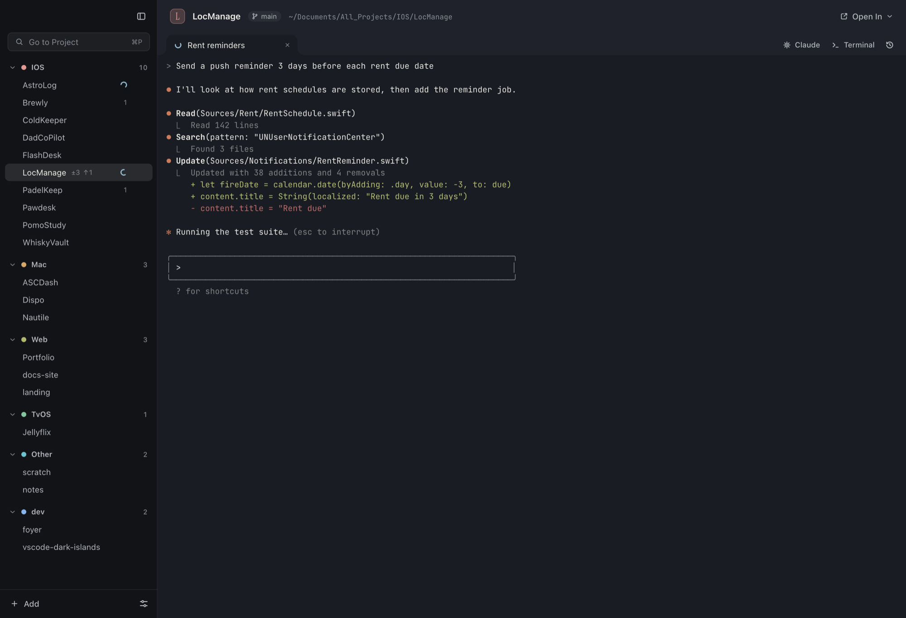
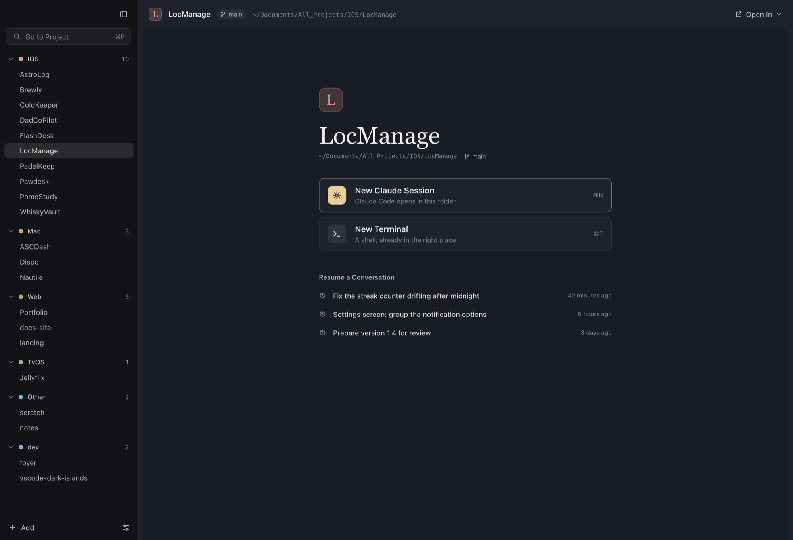
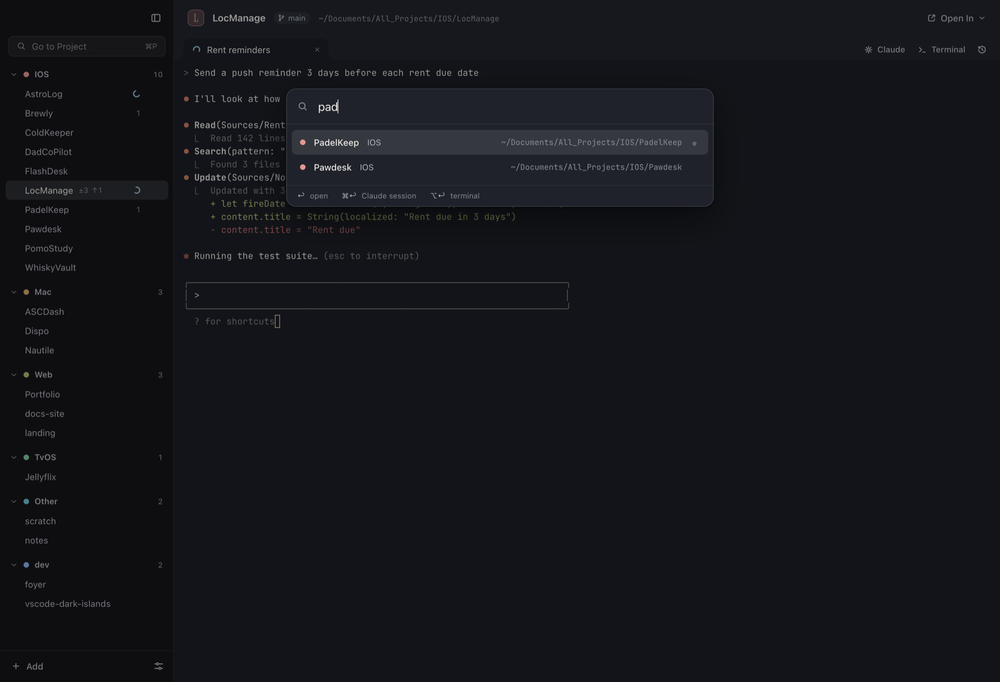

# Nautile

**A native macOS workspace for Claude Code.**

When you run Claude Code on a dozen projects at once, the hard part is no longer writing code. It is knowing which session is still working, which one is waiting for your answer, and where you left each conversation. Nautile is built around that problem.

## Download

**[Nautile 0.2.2 for macOS](https://github.com/McSon2/nautile/releases/latest)** · Apple silicon · macOS 13 or later · signed with a Developer ID and notarized by Apple.

Open the disk image and Nautile installs itself into `/Applications`.

Requires [Claude Code](https://docs.claude.com/en/docs/claude-code) installed on your Mac.

## What it does

- **Every project, one click from Claude.** Nautile scans the folders where your projects live, sorts them into categories, and opens each one on a home screen: start a Claude Code session in that folder, or a terminal already in the right place.
- **Live state for every session.** Claude sessions start with Nautile's own Claude Code hooks; each event is relayed to the app, so the sidebar shows whether every session is working, waiting for your reply, or idle. A native notification takes you to the tab that needs you.
- **Resume any conversation.** Sessions start with a known id, so a closed tab reopens exactly where it was. Recent conversations are listed per project.
- **Git status at a glance.** Changed files and commits ahead/behind for each project, read without taking git's index lock away from a running session.
- **Keyboard first.** `⌘P` jumps to any project (`⌘↩` opens it straight into Claude), `⌘N` new Claude session, `⌘T` new terminal, tabs or a grid per project, open in Xcode, Ghostty, Terminal or Finder.

## How it is built

- Tauri 2 (Rust) and Svelte 5, about 5 MB to download.
- One real PTY per tab; xterm.js with WebGL rendering and flow control, so long Claude outputs never freeze the window.
- Claude Code hooks relayed over a local Unix socket. Nothing leaves your Mac.

## Roadmap

Features built on the Claude API: summaries of what each session did while you were away, and search across the conversations of every project.

## Feedback

Issues and ideas are welcome in [Issues](https://github.com/McSon2/nautile/issues), or by email at maxime@maximesaltet.com.

More at [maximesaltet.com/nautile](https://maximesaltet.com/nautile).

---

© 2026 Maxime Saltet. The source code is not published; this repository hosts releases and documentation.
